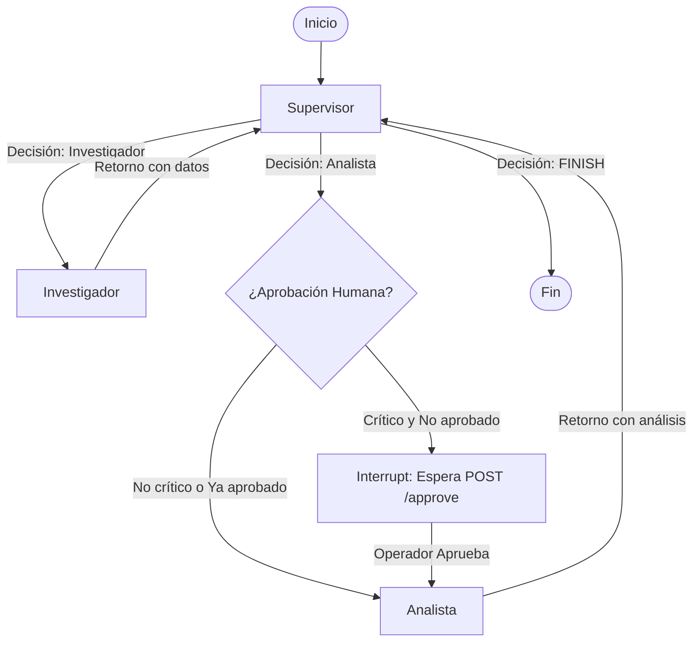

# Pre-entrega 7: API REST de Producción y Monitoreo Activo

Proyecto correspondiente a la **Pre-entrega 7** del curso de IA / Agentes de Coderhouse. Consiste en la evolución del Orquestador Multi-Agente Jerárquico hacia una **API REST de producción asíncrona** construida con **FastAPI**, persistencia de estado y checkpointing en **Redis**, capa de observabilidad activa con **Arize Phoenix** y soporte de interacción **Human-in-the-Loop (HITL)**.

---

## Consigna y Requerimientos de la Entrega

### Objetivo
Exponer el sistema multi-agente del Módulo 6 mediante una API REST asíncrona, desacoplando la recepción de peticiones de la ejecución del grafo, persistiendo el estado en Redis, instrumentando observabilidad activa y permitiendo la intervención humana en tareas críticas.

### Requerimientos Técnicos Cumplidos
1. **Endpoints Asíncronos (No Bloqueantes):** 
   - `POST /tasks`: Recibe la solicitud del usuario, registra el trabajo en Redis, lo encola con `BackgroundTasks` y devuelve inmediatamente un `job_id` con código HTTP `202 Accepted`.
   - `GET /tasks/{id}`: Endpoint de polling para consultar el estado del trabajo sin bloquear el Event Loop(`PENDING`, `RUNNING`, `WAITING_APPROVAL`, `DONE`, `FAILED`).
   - `POST /tasks/{id}/approve`: Endpoint Human-in-the-loop para reanudar o rechazar ejecuciones pausadas.

2. **Gestión de Estado y Checkpointing con Redis:** 
   - Implementación de `AsyncRedisSaver` para persistir el estado de LangGraph.
   - Manejo defensivo: si el LLM falla (ej. Rate Limit) o hay una excepción, el estado pasa a `FAILED` evitando polling infinito.

3. **Observabilidad Activa:** 
   - Instrumentación con Arize Phoenix y OpenTelemetry.
   - Registro en tiempo real de trazas, tokens(input/output) , costo por ejecución y latencia de cada nodo.

4. **Human-in-the-Loop (HITL):** 
   - Si la tarea se envía con `critical: true`, el grafo se detiene en el nodo `AprobacionHumana` mediante `interrupt()`. Espera hasta recibir aprobación explícita del operador humano (agente Analista) para reanudar.

5. **Prueba de Carga Concurrente:** 
   - Script automatizado `test_concurrency.py` que lanza 5 peticiones simuladas simultáneas contra la API y generar métricas en el dashboard.
   - Para respetar el límite del tier gratuito de Gemini (~15 RPM), el worker implementa un `Semaphore(1)` y un cooldown de 20s entre tareas. La API sigue siendo asíncrona (recibe 5 peticiones simultáneas), pero el worker las procesa en cola para garantizar el 100% de éxito.

---

## Diagrama Mermaid del Grafo con HITL


---
##Estructura del Repositorio 
```	
mi-api-agente/
	├── app/
	│   ├── main.py            # Endpoints FastAPI
	│   ├── graph.py           # Grafo LangGraph + Nodos + HITL (interrupt)
	│   ├── worker.py          # Procesamiento en background, Semáforo y Checkpointer
	│   ├── observability.py   # Configuración de Arize Phoenix
	│   ├── state.py           # Esquema del TeamState (TypedDict)
	│   └── config.py          # Multiproveedor LLM (Gemini, Groq, OpenAI, Mock)
	├── screenshots/           # Capturas de trazas, tokens, p95 y consola HITL
	├── test_concurrency.py    # Script para lanzar las 5 peticiones concurrentes
	├── requirements.txt       # Dependencias del proyecto
	├── docker-compose.yml     # Orquestación de contenedores (API + Redis + Phoenix)
	├── .env.example           # Plantilla de variables de entorno
	└── README.md              # Documentación
```
---

## Pasos a seguir:
**Configuración inicial** 

	Renombrar archivo .env.example a .env y configurá las claves
	LLM_PROVIDER=gemini
	GOOGLE_API_KEY=tu_api_key_aqui
	TAVILY_API_KEY=tu_api_key_aqui
	
**Despliegue con Docker Compose**
	
	docker-compose up --build
	API REST (FastAPI): http://localhost:8000
	Dashboard Arize Phoenix: http://localhost:6006
	
**Ejecución Local en Entorno Virtual**	
1. **Iniciar el servidor de Redis:**	
	
		-- docker run -d -p 6379:6379 --name redis_agente redis/redis-stack-server:latest
	
2. **Crear y activar entorno virtual:**
	
		-- python -m venv venv
		-- venv\Scripts\activate    
	
3. **Instalar dependencias de requirements.txt:**
	
		-- pip install -r requirements.txt
	
4. **Iniciar la API FastAPI:** 
	
		-- uvicorn app.main:app --host 0.0.0.0 --port 8000 --reload
	
**Guía de Uso de los Endpoints(Windows PowerShell)**
1. **Crear una nueva tarea (POST /tasks)**

		$body = '{"query": "Investigar LangGraph en FinTech", "critical": false}'
		$resp = Invoke-RestMethod -Uri "http://localhost:8000/tasks" -Method Post -ContentType "application/json" -Body $body
		$resp
		 
2. **Consultar el estado del trabajo (GET /tasks/{job_id})**
	
		$jobId = $resp.job_id # Reemplazar por tu ID real si es otra sesión
		Invoke-RestMethod -Uri "http://localhost:8000/tasks/$jobId" -Method Get
	
3. **Aprobar una tarea pausada por HITL (POST /tasks/{job_id}/approve)**
	
		$appr = '{"approved": true, "reason": "Aprobación del operador"}'
		Invoke-RestMethod -Uri "http://localhost:8000/tasks/$jobId/approve" -Method Post -ContentType "application/json" -Body $appr
	 
**Prueba de Carga y Concurrencia (5 Peticiones Simultáneas)**
	
	python test_concurrency.py
